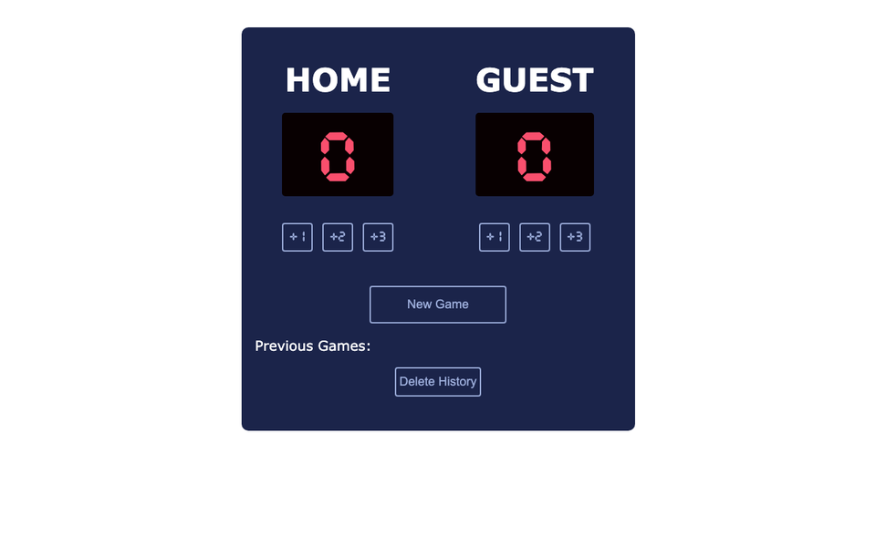

# Basketball Scoreboard 🏀

A scoreboard for a pickup basketball game with friends: add points to each team and see who is winning.

**Live demo:** https://mccprogrammer.github.io/basketball-scoreboard/



## Features

- +1, +2 and +3 buttons for the home and guest teams
- New game, with the previous games kept in a history you can clear
- Scores and history saved in `localStorage`, so a refresh loses nothing
- Responsive layout for phones and desktops

## Run it locally

No build step: clone the repo and open `index.html` in a browser.

```bash
git clone https://github.com/MCCProgrammer/basketball-scoreboard.git
open basketball-scoreboard/index.html
```

## Built with

HTML, CSS and plain JavaScript.

---

One of my first web projects. More of my work at [mccprogrammer.com/projects](https://mccprogrammer.com/projects).
